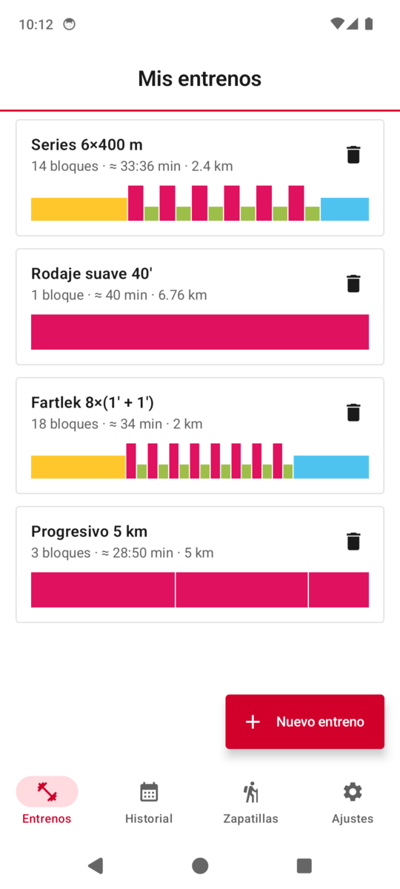
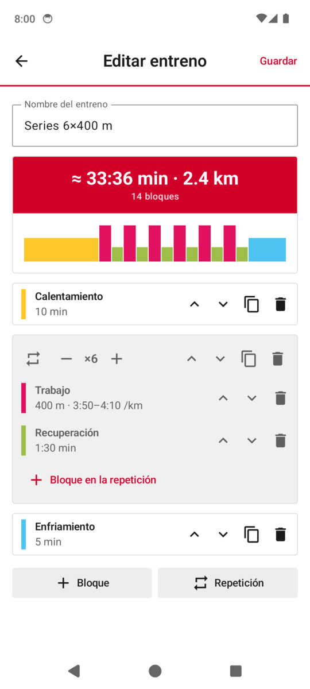
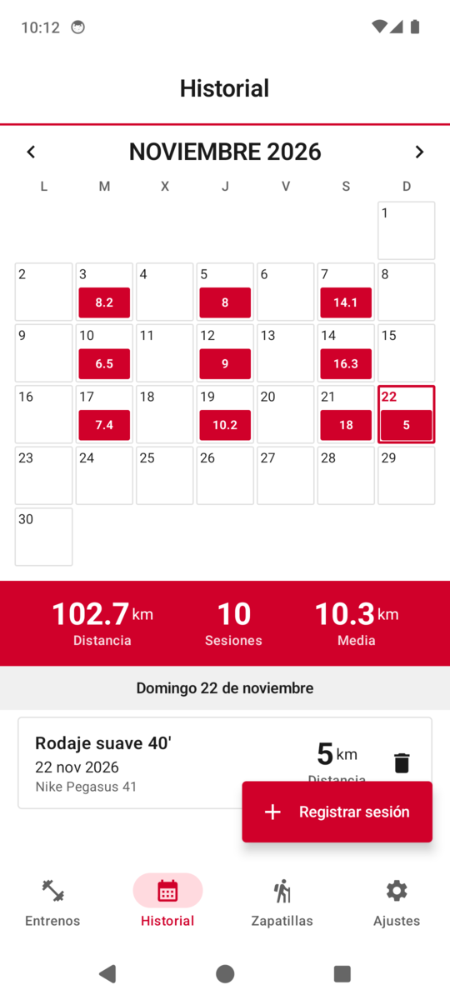
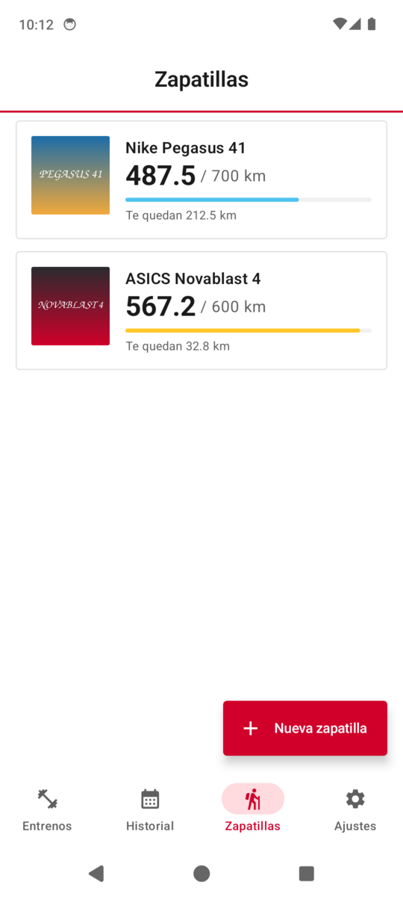
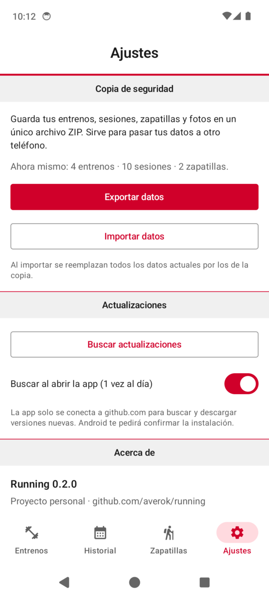

# Running

App Android (Kotlin + Jetpack Compose) para crear entrenos por bloques, registrar sesiones y llevar el control de km de las zapatillas.

> **Proyecto personal.** Lo desarrollo para mi propio uso y a mi ritmo. El código es público por si te resulta útil, pero no ofrezco soporte ni garantizo que acepte contribuciones.

## Capturas

<p>
  
  
  
  
  
</p>

## Funciones
- **Entrenos por bloques**: calentamiento, trabajo, recuperación, enfriamiento y descanso, con repeticiones y objetivo opcional (ritmo, velocidad o pulsaciones).
- **Historial en calendario**: sesiones por día, con km y resumen mensual.
- **Zapatillas**: foto del modelo, km acumulados con límite personalizable y aviso al acercarse o alcanzarlo.
- **Copia de seguridad**: exporta e importa todos los datos (con las fotos) en un ZIP, para cambiar de teléfono.
- **Actualizaciones**: avisa de versiones nuevas publicadas en GitHub y las instala con un toque.

## Instalación y actualizaciones
Descarga el último APK desde [Releases](https://github.com/averok/running/releases) e instálalo (Android te pedirá permitir instalar apps desconocidas desde tu navegador o gestor de archivos).

Después, la app busca sola versiones nuevas (como mucho una vez al día, se puede desactivar en *Ajustes*) y, si hay una, descarga el APK, lo verifica y abre el instalador de Android para que confirmes. **Lo único que hace la app en red es hablar con github.com para esto.**

Los APK se firman con una clave propia. Para comprobar que uno es auténtico:
```
apksigner verify --print-certs running-X.Y.Z.apk
# SHA-256 del certificado:
# ED:1C:11:39:ED:68:74:5C:63:4E:5F:B4:DB:F3:DF:24:D9:5C:F9:07:7D:9B:C8:2E:F3:F7:B2:35:00:F6:8D:3B
```

## Modelo
- `Workout` → lista de `WorkoutItem`: `SingleItem` (un bloque) o `GroupItem` (×N repeticiones de varios bloques).
- `Block` → tipo (calentamiento, trabajo, recuperación, enfriamiento, descanso) + `EndCondition` (tiempo, distancia, manual) + `BlockTarget` opcional (ritmo, velocidad, pulsaciones).
- Persistencia en JSON local (`filesDir/workouts.json`).

## Desarrollo
```
export JAVA_HOME=~/dev/jdk ANDROID_HOME=~/dev/android-sdk
./gradlew assembleDebug
scripts/emulator.sh &            # AVD "running", ventana visible
adb install -r app/build/outputs/apk/debug/app-debug.apk
adb shell am start -n app.running/.MainActivity
```
